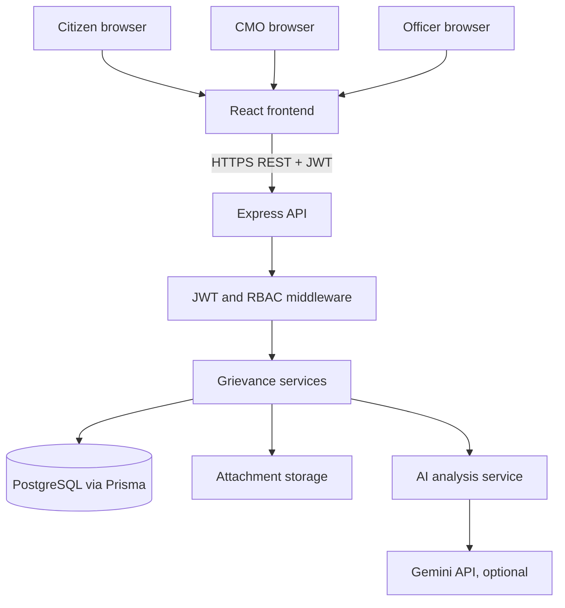

# 02 – System Architecture

## Components
- React + Vite frontend, styled with custom responsive CSS.
- Express REST API running on Node.js.
- PostgreSQL relational database accessed through Prisma ORM.
- JWT bearer authentication and role-based authorization middleware.
- Gemini 2.0 Flash API for AI suggestions when `GEMINI_API_KEY` is configured; labelled local keyword fallback otherwise.
- Multer local file upload middleware for JPG, PNG and PDF files.

## Request flow
Browser → React UI → Express API → authentication/authorization → business logic → Prisma → PostgreSQL. AI analysis calls the Gemini API from the backend; the API key is never sent to the browser.

## Architecture diagram

## Deployment topology
Deploy the Vite frontend as a static site, the Express API as a Node service and PostgreSQL as a managed database. Configure `VITE_API_URL` in the frontend and `CLIENT_ORIGIN` in the API. Local upload storage must be replaced with persistent/private object storage for production.
