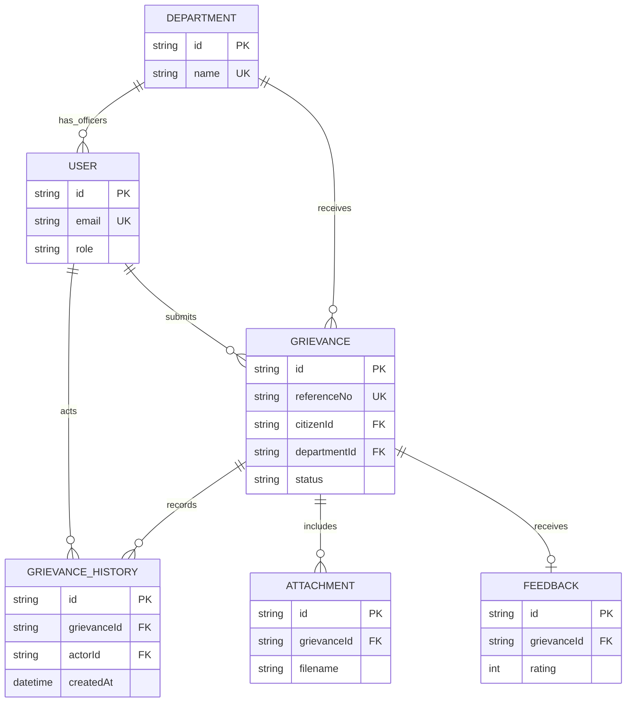

# 03 – Database Design

## Entities
- **User:** citizen, CMO administrator or officer; officers can be associated with a department.
- **Department:** department name and description.
- **Grievance:** citizen, reference number, district, category, subject, description, AI suggestions, priority, status, assigned department and action details.
- **GrievanceHistory:** append-only status event with remarks, actor and timestamp.
- **Attachment:** uploaded file metadata linked to a grievance.
- **Feedback:** one citizen rating/comment per grievance.
- **ContactEnquiry:** public contact form submissions.

## Relationships
- Department 1—many Users; Department 1—many Grievances.
- User 1—many Grievances as citizen; User 1—many GrievanceHistory events as actor.
- Grievance 1—many GrievanceHistory; Grievance 1—many Attachments; Grievance 1—zero/one Feedback.

## ER diagram

## Constraints and design notes
Unique email, department name and grievance reference number; unique feedback grievance ID; status/role/priority enums; cascade deletion for dependent history/attachments/feedback. Prisma schema is in `server/prisma/schema.prisma`.
